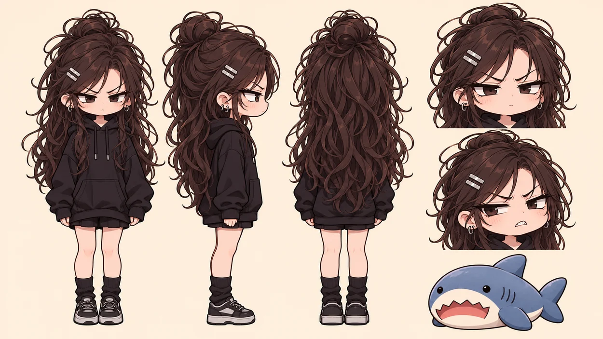
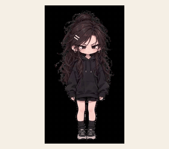
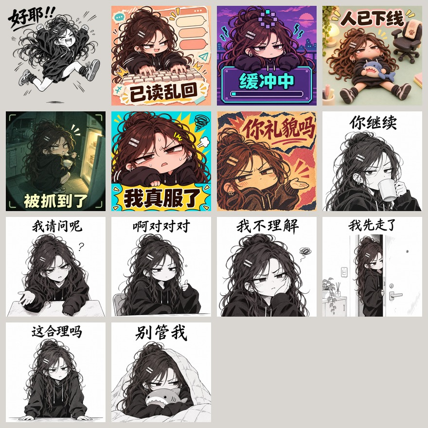

# 乌栗 Wuli · DSH 桌宠

> 「你忙你的。晚饭给你留了，顺便的。」

乌栗是个住在屏幕角落的桌面室友。她穿着宽大的黑卫衣，头发上别着两枚银发夹，平时半眯着眼看你忙。被催了会皱眉，做完了会偷着高兴，困了就抱着她的蓝鲨鱼布偶「蓝鳍」睡觉。

| 想拿什么 | 去哪里 |
|---|---|
| 装到 DSH，含 **40 段透明动画**、角色配置和安装脚本 | [下载 DSH 安装包](https://github.com/Humble1324/wuli-dsh-pet/releases/download/v0.1.0/wuli-dsh-v0.1.0.zip) |
| 做表情、短漫或二创，另含 **30 张 PNG、8 张 GIF**、三视图和制作视频 | [下载完整素材包](https://github.com/Humble1324/wuli-dsh-pet/releases/download/v0.1.0/wuli-release-v0.1.0.zip) |
| 查看版本与文件校验值 | [打开 v0.1.0 发布页](https://github.com/Humble1324/wuli-dsh-pet/releases/tag/v0.1.0) |

## 她在桌面上会做什么

| 白天守桌 | 晚上省电 |
|---|---|
|  |  |
| 看上去有点不耐烦，其实是在等你收工。 | 「我就闭一会儿眼。」 |

- 点一下会回你挥手、瞪眼或傲娇反应。闲下来会走路、左转跑和漂浮踏步。
- 开始工作时会思考，等确认时会张望，完成了就庆祝。她还会发呆、对屏自言自语，或者一边擦桌一边念叨。
- 入睡、侧蜷循环和醒来是三段独立动画。睡熟了还可能嘟囔一句「蓝鳍……别抢被子」。

## 她在聊天框里更有戏

「好耶！！」会蹦到双脚离地，「缓冲中」是像素游戏弹窗，「人已下线」变成抱鲨鱼瘫在地上的软陶乌栗。完整素材包里还有彩色拼贴、厨房监控视角和黑白漫画，解压后可以单张取用。

## 安装到 DSH

1. 下载并完整解压 **DSH 安装包**。角色按 [dsh-pet](https://github.com/PC2005-cloud/dsh-pet) v0.4.9 的文件结构准备。
2. 把解压后的 `pet/` 内容复制到目标实例的 `<DSH_HOME>\dsh-pet\pet\`。也可以在解压目录运行 `.\install-my-pet.ps1 -DshHome "目标实例的 DSH_HOME"`，脚本会备份同名角色文件。
3. 刷新或重启 DSH，在桌宠设置里选择 **乌栗 Wuli**。

碎碎念和梦话使用宿主配置的对话模型，余额联动取决于宿主 main 设置。配置、素材和临时目录安装已检查，实际事件触发和移动方向待 DSH 实机验收。

## 角色与项目资料

- [乌栗人设手册](character.md) · 名字、世界观、视觉规范和她说话的方式
- [114 项制作路线图](roadmap.md) · 当前版本含 40 段动作，扩展动作和吃白饭玩法仍在路线图中
- [MIT 许可](LICENSE) · [角色素材许可 CC BY 4.0](ASSET-LICENSE.md)

素材包含 AI 辅助创作。许可适用于贡献者有权授权的内容。
